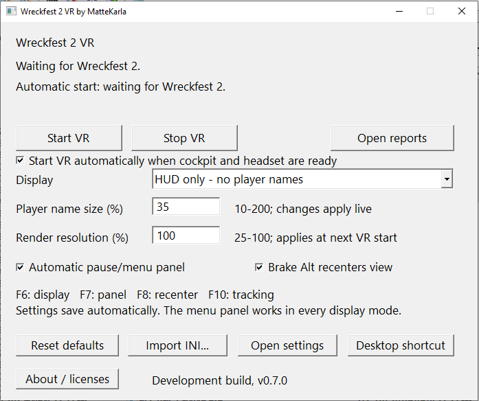

# Wreckfest 2 VR by MatteKarla

An unofficial, unsupported VR mod for **Wreckfest 2**. It is not affiliated with or supported by the game's developers. Both the game and the mod are in early access, so expect bugs, missing effects and crashes.

The mod adds stereoscopic cockpit rendering and head tracking, so you can look around and lean inside the car. A transparent HUD can show race information and player names. Menus and loading screens automatically use a flat panel in VR.

## Getting started

Currently tested on Windows with **Meta Quest 3 through Virtual Desktop and VDXR**. You need your own copy of Wreckfest 2 and a working VR connection.

1. Open **Wreckfest2VR.exe**. No installation or command-line arguments are needed.
2. Connect your headset through Virtual Desktop, using VDXR as the OpenXR runtime.
3. Start Wreckfest 2 normally. **Disable SSAO Quality** in the game's graphics settings; VR will stop if SSAO is enabled.
4. Load an **offline race**, enter the cockpit and resume the game. With automatic start enabled, VR starts once the cockpit and headset are ready. You can also click **Start VR** manually.
5. Sit comfortably, face forward and press **F8** to recenter. Recenter keeps the world level, even if your head is tilted.

**Stop VR** leaves Wreckfest running and suspends automatic starting. Click **Start VR**, or turn automatic start off and on, to enable it again.

## Recenter from your steering wheel

In Wreckfest's control settings, bind **Brake Alt** (alternate brake) to a convenient steering-wheel button. Leave **Brake Alt recenters view** enabled in the launcher. Pressing that button then recenters VR, just like F8. The button still performs its normal in-game Brake Alt action.

## Settings and controls

Choose **All** to show the HUD and player names, **HUD only** to hide player names, or **None** to hide both. Player name size changes live. Render resolution changes apply the next time VR starts; lower values can improve performance.

Keep Wreckfest focused when using these controls:

| Control | Action |
| --- | --- |
| F6 | Cycle All / HUD only / None |
| F7 | Manually switch between the flat panel and stereo |
| F8 or Brake Alt | Recenter |
| F10 | Toggle head tracking |

Settings save automatically to `%LOCALAPPDATA%\WF2VR\settings.ini`. Use **Open settings** to find them and **Desktop shortcut** to create a launcher shortcut.

Keep SSAO disabled and use offline play. Some effects are incomplete, and track changes can still crash the game. If something fails, use **Open reports** to find the diagnostic logs; restart Wreckfest after a game/GPU crash before trying again.
